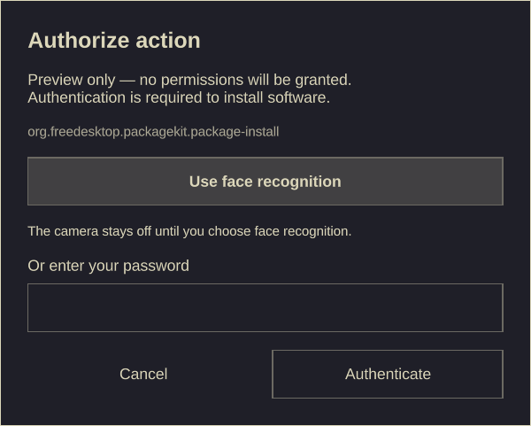

# Howdy Manual

Read the permission request before your camera starts. An Omarchy Polkit agent with an explicit **Use face recognition** button and a small companion PAM module for Howdy Next.

[繁體中文](docs/README.zh-TW.md)



The dialog shows the complete request and its Polkit action ID. Choose face recognition, enter a password, or cancel. Pressing Enter in an empty GUI password field never starts a face scan. English and Traditional Chinese follow your system locale. All request text is displayed as plain text.

## Requirements

- Omarchy **4.0.6 / Quattro** and its native Quickshell Polkit service. Tested with Quickshell `0.3.2.r7.g2b4501a`.
- **Howdy Next 3.4.2**, already working with enrolled faces. No face models, camera settings, or biometric data are included or changed.
- `pam_howdy.so` must already be the first `auth` method in `/etc/pam.d/polkit-1`, with `auth include system-auth` as its password fallback. Other PAM layouts are deliberately refused.
- `cc`, Make, Linux-PAM headers, Python 3 and Node.js for building and testing. On Arch, `base-devel`, `pam`, `python` and `nodejs` provide them.
- A CJK font for Chinese text; Noto Sans CJK TC is preferred.

## Install

Review the repository first. Omarchy adds the plugin **disabled** and does not execute installation hooks or request root access.

```sh
omarchy plugin add https://github.com/TW527E/omarchy-howdy-manual.git
cd "$HOME/.config/omarchy/plugins/io.github.tw527e.howdy-manual"
make test
sudo python3 scripts/pam_setup.py install
omarchy plugin enable io.github.tw527e.howdy-manual
omarchy restart shell
```

If you use another custom Polkit agent, disable it before enabling this one. The built-in `omarchy.polkit` is replaced automatically. Restart the shell while the desktop is unlocked so the new agent can register cleanly.

To also make **sudo** wait for a choice, use `install --sudo` instead of `install` above. Howdy must already be configured in `/etc/pam.d/sudo`. In a terminal, type your password or press Enter to start face recognition. Ctrl+C cancels.

For a graphical invocation without a terminal, use `pkexec /usr/bin/python3 "$PWD/scripts/pam_setup.py" install`. The plugin itself never runs privilege escalation or installs the module automatically.

## Preview

```sh
omarchy shell shell summon io.github.tw527e.howdy-manual '{}'
```

This opens a clearly labelled preview. It never starts a camera, asks PAM to authenticate, or grants permissions. Typed preview input is discarded.

## What changes

The root helper installs `/usr/local/lib/security/pam_howdy_choice.so` and wraps the existing Howdy line in each selected PAM service:

```text
auth [success=ignore ignore=1 default=die] /usr/local/lib/security/pam_howdy_choice.so
auth sufficient pam_howdy.so
auth include system-auth
```

The choice module always asks first, including when a caller supplied an existing token. An explicit empty response selects Howdy; a password skips Howdy and is passed to the existing password stack. Cancelled or failed conversations fail closed. **The choice module does not verify identity or grant access.** Howdy or the existing password stack must still succeed. No simulated Enter key is used.

Original PAM contents and installation state are saved in root-only `/var/lib/omarchy-howdy-manual/`. Installation and removal validate the supported layout before changing files, write files atomically, and roll back if a later write fails. Removal refuses to overwrite PAM files or a module changed after installation. The helper is intentionally conservative; unsupported stacks require manual review.

The manifest retains `omarchy.clonedFrom: omarchy.polkit` intentionally: this is a replacement authentication service. On the tested shell, that field also gives it the host's private authentication-service lifecycle and restores the built-in agent when disabled. It is not a standalone visual widget.

## Remove or update

Restore the system integration **before** removing the checkout:

```sh
cd "$HOME/.config/omarchy/plugins/io.github.tw527e.howdy-manual"
sudo python3 scripts/pam_setup.py remove
omarchy plugin remove io.github.tw527e.howdy-manual
omarchy restart shell
```

Removal restores the exact pre-install PAM configuration, which may resume automatic face authentication if that was your previous configuration. A recovery record remains under `/var/lib/omarchy-howdy-manual-restored-*`.

Disabling only the UI does not uninstall the PAM module. Password entry continues through the ordinary agent; the explicit face button belongs to this plugin. To update the PAM helper, restore it with `remove`, review the plugin update, then build, test and install again. A second `install` refuses to overwrite an existing recovery record.

## Limits and verification

- This handles Polkit prompts; optional sudo integration is separate. It does not implement a lock screen, login manager or global Howdy toggle. Lock Explorer users can independently run `omarchy shell lock setFaceStart off` to keep its existing manual face button.
- Apps decide how much information Polkit receives. Some provide an operation description rather than a recognizable application name. Action IDs are shown without inventing a caller identity.
- Existing Polkit rules and valid authentication caches can grant an action without a new prompt. This plugin does not change those rules.
- A running face scan finishes before PAM can offer the password fallback. Cancel remains available throughout.
- Omarchy plugins run unsandboxed as your user. This plugin follows the shell's private authentication-service storage; it cannot make other untrusted desktop code safe.

`make test` runs PAM conversation/branch tests, installer lifecycle and rollback tests, and prompt-state tests without using a camera or your real password. `omarchy plugin validate .` validates the real manifest. Native QML render checks and limitations are recorded in [validation notes](docs/validation.md). Test on your own hardware before relying on face authentication.

## License and credits

MIT. Derived from Omarchy's Polkit agent by David Heinemeier Hansson and contributors, with new integration by TW527E. See [LICENSE](LICENSE). Howdy Next is a separate dependency; its code and face models are not bundled.

Prepared using the [Omarchy publishing guide](https://plugins.omarchy.org/publish.html). Publishing this repository does not imply Marketplace approval.
