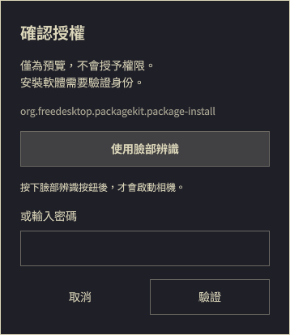

# Howdy Manual

先看清楚授權請求，再按「使用臉部辨識」。這個插件包含 Omarchy 的 Polkit 授權介面，以及讓 Howdy Next 等待手動選擇的小型 PAM 模組。



## 安裝

已在 Omarchy 4.0.6、Quickshell 0.3.2.r7.g2b4501a、Howdy Next 3.4.2 上測試。需要先安裝 Howdy、登錄臉部，並讓 `/etc/pam.d/polkit-1` 的第一個 auth 項目使用 `pam_howdy.so`，後方保留 `auth include system-auth`。安裝程式會拒絕不支援的 PAM 結構。

需要 C 編譯器、Make、Linux-PAM 標頭、Python 3 與 Node.js；Arch 的 `base-devel`、`pam`、`python`、`nodejs` 提供這些工具。中文介面優先使用 Noto Sans CJK TC。

```sh
omarchy plugin add https://github.com/TW527E/omarchy-howdy-manual.git
cd "$HOME/.config/omarchy/plugins/io.github.tw527e.howdy-manual"
make test
sudo python3 scripts/pam_setup.py install
omarchy plugin enable io.github.tw527e.howdy-manual
omarchy restart shell
```

請在桌面未鎖定時重啟 shell。若目前使用其他自訂 Polkit 插件，先停用它；內建 Polkit 會自動被替換。Omarchy 安裝插件本身不會執行 root 安裝步驟。

如需一起處理 sudo，將上述 `install` 改成 `install --sudo`。sudo 必須原本就有配置 Howdy。終端機輸入密碼即可使用密碼驗證；直接按 Enter 才啟動辨識，Ctrl+C 取消。

## 使用方式

- 圖形視窗顯示請求內容與 Polkit action ID。按「使用臉部辨識」才啟動相機，也可輸入密碼或取消。空白密碼欄按 Enter 不會啟動辨識。
- 辨識過程會顯示狀態；如果未成功，PAM 才會繼續密碼驗證。期間仍可取消。
- 英文／繁體中文依系統語系選擇。過長的請求內容可捲動。
- `omarchy shell shell summon io.github.tw527e.howdy-manual '{}'` 可開啟預覽。預覽不使用相機、不授權，輸入內容直接丟棄。

## 移除與還原

```sh
cd "$HOME/.config/omarchy/plugins/io.github.tw527e.howdy-manual"
sudo python3 scripts/pam_setup.py remove
omarchy plugin remove io.github.tw527e.howdy-manual
omarchy restart shell
```

原 PAM 設定儲存在只有 root 能讀取的 `/var/lib/omarchy-howdy-manual/`。還原會恢復安裝前的行為；如果安裝前是自動辨識，也會恢復自動辨識。若安裝後有人修改 PAM 或模組，程式會停止，避免覆寫後來的設定。更新 PAM 模組前也需先還原，再重新建置、測試與安裝。

只停用介面不會移除 PAM 模組。完整的安裝、權限設計及限制見 [英文說明](../README.md)。

## 範圍與限制

這不是鎖定畫面插件，也不會修改相機、臉部模型、系統免驗證規則或授權快取。Lock Explorer 的手動模式可另外使用 `omarchy shell lock setFaceStart off`。

應用程式不一定提供軟體名稱，因此顯示實際取得的操作說明及 action ID。PAM 模組只取得驗證方式選擇，不會單獨授權；臉部或密碼仍須成功驗證。

公開 GitHub 儲存庫不代表已獲得 Omarchy Marketplace 審核上架。
